# KSI Site Intelligence Platform

> **물리적 현장의 관측을, 사람·소프트웨어·외부 AI가 재사용하는 근거형 Site State와 Change로 바꾸는 기반**
>
> 첫 적용: 건설·토공 주간 현장 관리 — DSM·정사영상 기반 변화·물량 검토와 구역 데이터 활용
>
> **주식회사 케이에스아이 (KSI Corporation) · 대표번호 043-288-4860**

[](services/core/pyproject.toml)
[](apps/dashboard/package.json)
[](apps/dashboard/package.json)
[](services/core/)
[](tests/contract/)
[](apps/dashboard/)

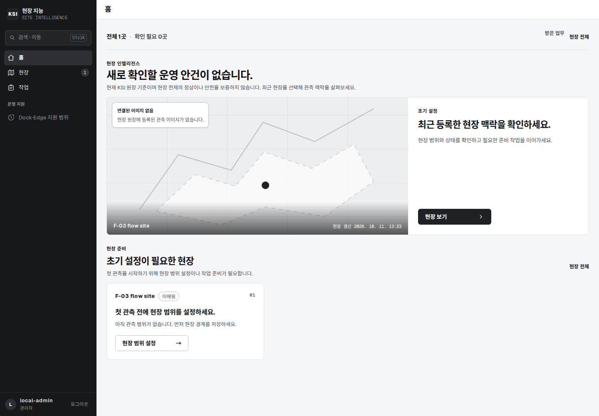

## 시연 영상 (16초, 합성 데모 현장)

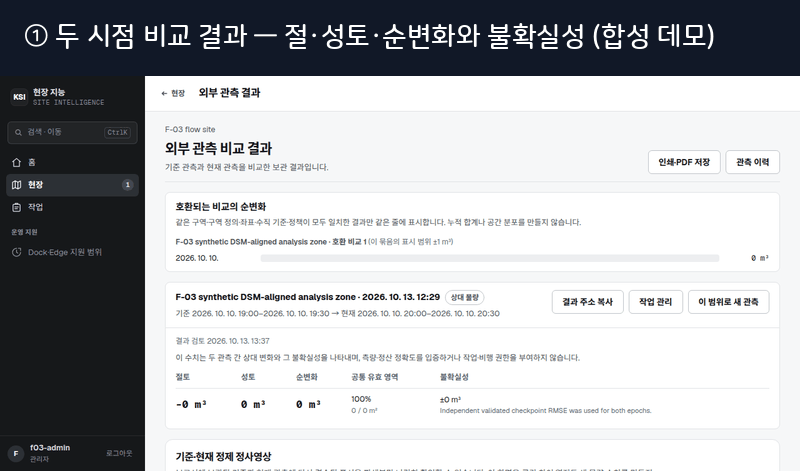

> 자동 재생이 안 되면 [`demo-1440.mp4`](docs/portfolio/demo-1440.mp4)를 내려받아 보세요.
> 로그인 → 현장 목록 → 현장 상세 → 분석 기록 → 관측 현황 → 홈 흐름의 실제 구동입니다.

## 목차

- [담당자가 1분 만에 보는 요약](#담당자가-1분-만에-보는-요약)
- [실제 구동 화면](#실제-구동-화면)
- [핵심 기능](#핵심-기능)
- [동작 흐름](#동작-흐름)
- [시스템 구성](#시스템-구성)
- [기술 스택](#기술-스택)
- [검증 현황](#검증-현황)
- [5분 만에 로컬 실행](#5분-만에-로컬-실행)
- [프로젝트 구조](#프로젝트-구조)
- [문서 안내](#문서-안내)
- [책임 경계](#책임-경계)
- [문의](#문의)

## 담당자가 1분 만에 보는 요약

건설 현장소장·공사관리자·본사 담당자가 매주 반복하는 질문에 답합니다.

| 담당자 질문 | KSI가 주는 답 |
|---|---|
| 이번 주 현장이 지난주와 뭐가 달라졌나? | 같은 WorkArea의 두 시점 관측을 고르고, Core가 **적합성 계산 실행을 기록**으로 남깁니다. 화면은 그 판단을 바꾸지 않습니다. |
| 숫자(절·성토·순변화)를 믿어도 되나? | 출처·좌표·변환·프로파일·유효/제외영역을 함께 기록합니다. 조건이 안 맞으면 수치를 추정하지 않고 **사유를 표시**합니다. |
| 외부 툴·AI와 이어쓸 수 있나? | UI·MCP·외부 API 소비 코드가 **같은 Core 자산·작업·결과 기록**을 씁니다. 대용량 바이트는 허용된 접근 참조로만 전달합니다. |
| 권한·반출은 안전한가? | 조직·현장·구역 범위 + 데이터 제공 권리·AI 동의·접근 회수를 매 요청마다 재확인합니다. |

제품에는 **데이터 제공 경로**(자료 탐색 → 구역 데이터 준비 → 외부 코드 활용)와
**분석 경로**(입력 admission → 고정 분석 → 결과·근거 조회)가 있습니다.
첫 분석 사례는 WorkArea별 주간 두 시점 지형 변화이며,
첫 플랫폼 검증 목표는 DSM·정사영상의 분석 + 외부 구역 데이터 활용 입증입니다.

```text
고객 관측/재구성 → 산출물·시점·구역·버전 등록과 검사 → Core 권한·용도별 적합성
        ├─ 데이터 경로: 자료 탐색 → 구역 데이터 준비 → 외부 코드 활용
        └─ 분석 경로: 입력 admission → 고정 분석 → 결과·근거 조회
                 공통 API / 선택한 MCP / Operations Console
```

## 실제 구동 화면

> 아래는 모두 실제 로컬 스택에서 구동된 **KSI Operations Console** 화면입니다.
> 현장명·수치는 합성 데모 데이터이며 흐름·권한·지속성은 실제 코드 그대로입니다.

### 1. 현장 분석 — 두 시점 비교 요청

같은 작업구역의 기준 관측과 현재 관측을 고르면 Core가 적합성 계산 실행을 기록합니다.

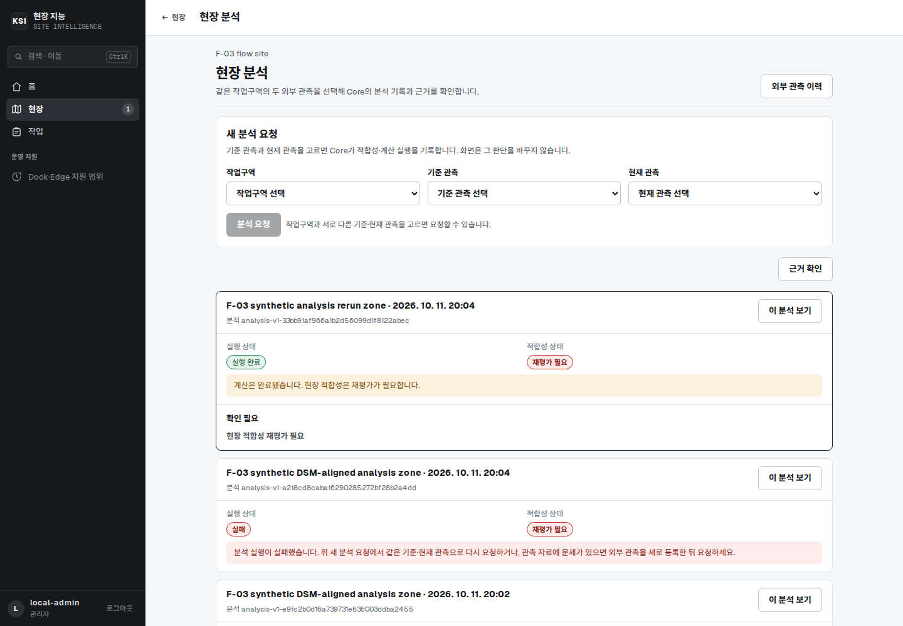

### 2. 새 관측 시작 — 외부 산출물 등록

이미 만든 정사영상·DSM을 등록해 비교 결과와 검토 상태를 확인하는 입구입니다.
비행·장비 제어는 이 화면에서 시작하지 않습니다.

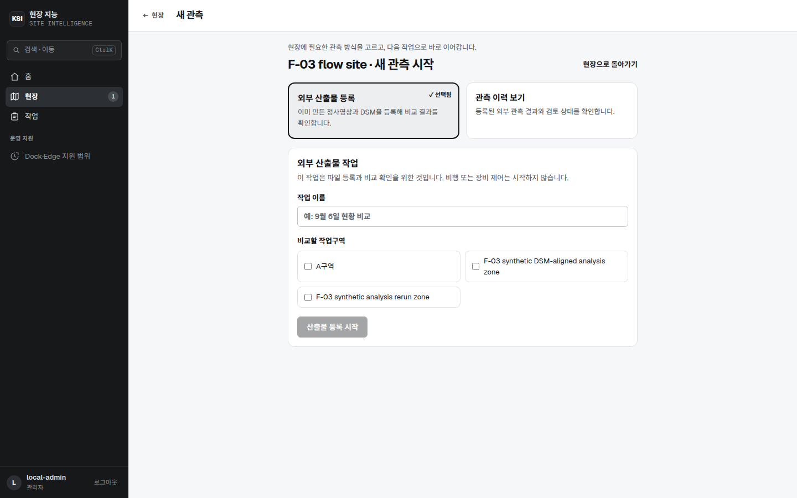

### 3. 현장 작업 — 검사와 비교 판정

봉인된 산출물의 검사 결과를 확인하고 기준 시점과의 비교 판정을 요청합니다.
담당·기한·종료 메모는 업무 종료로 남습니다.

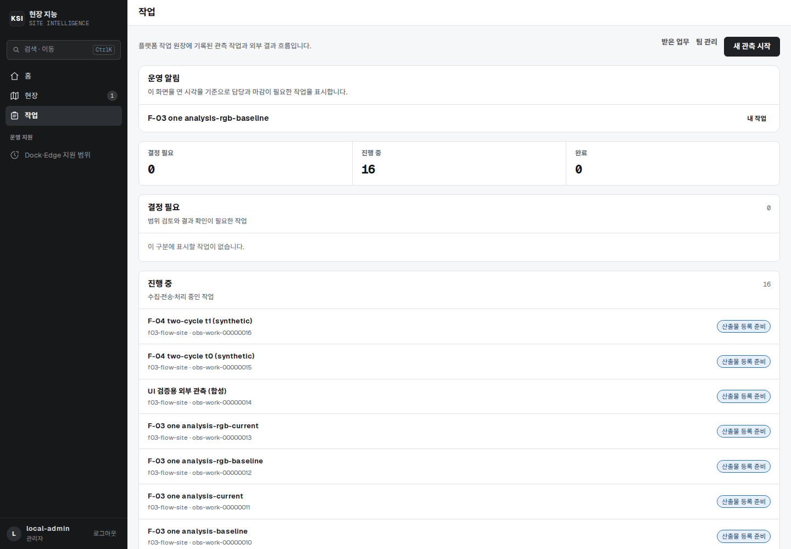

| 분석 목록 | 관측 현황 |
|---|---|
| 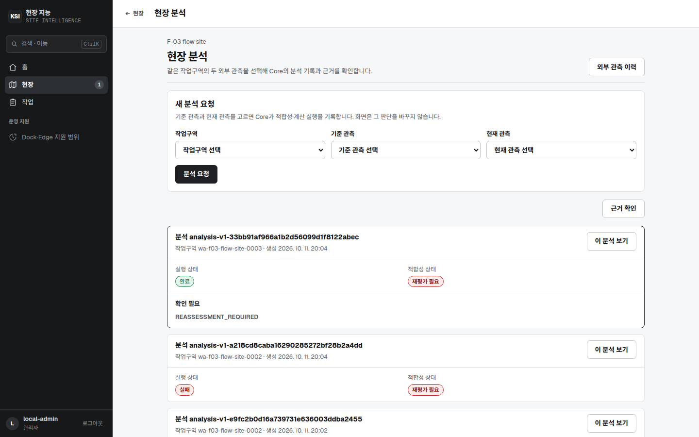 | 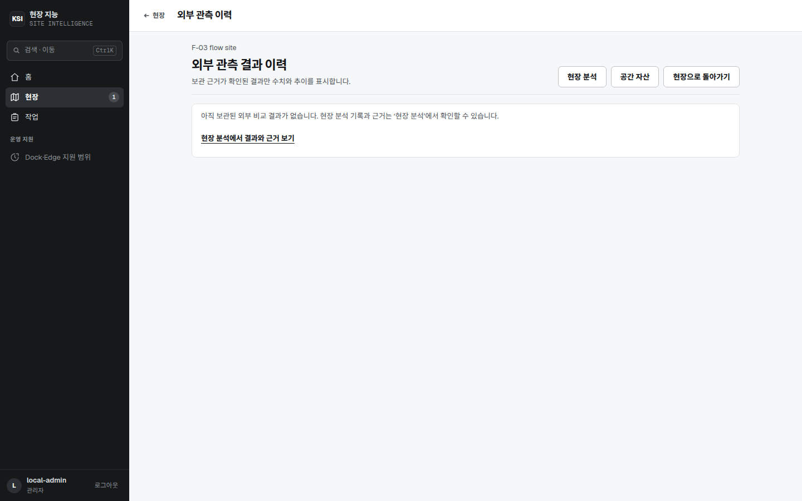 |

### 4. 검토 지속성 — 새로고침·Core 재기동 후에도 유지

외부 상대물량 리포트의 검토 기록이 페이지 새로고침과 Core 재기동(저널 replay) 뒤에도 그대로 표시됩니다.

| 새로고침 후 | Core 재기동 후 |
|---|---|
| 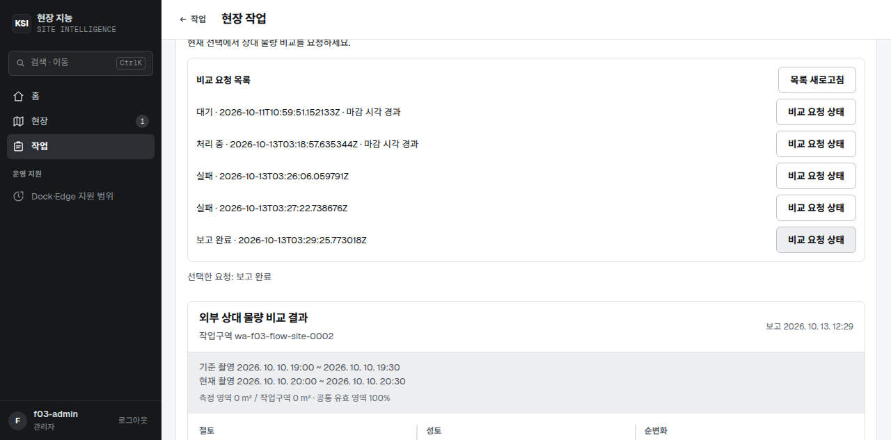 | 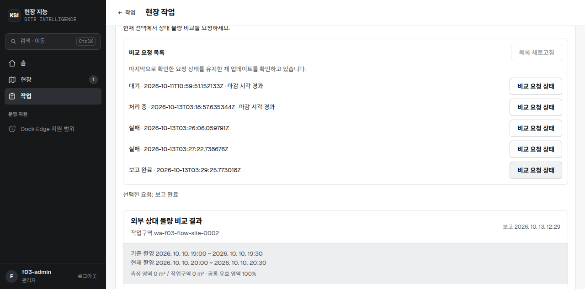 |

### 5. 현장 등록 — 좌표계·구역 포함

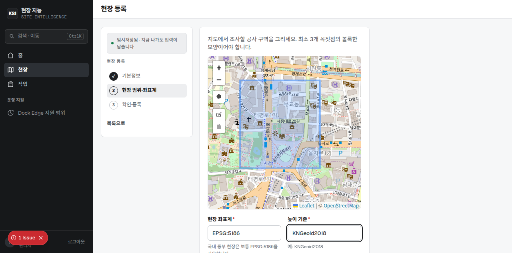

모바일(390px) 제한 표현과 외부 이력 화면도 동일 백엔드에서 동작합니다.

| 모바일 작업 | 외부 이력 |
|---|---|
| 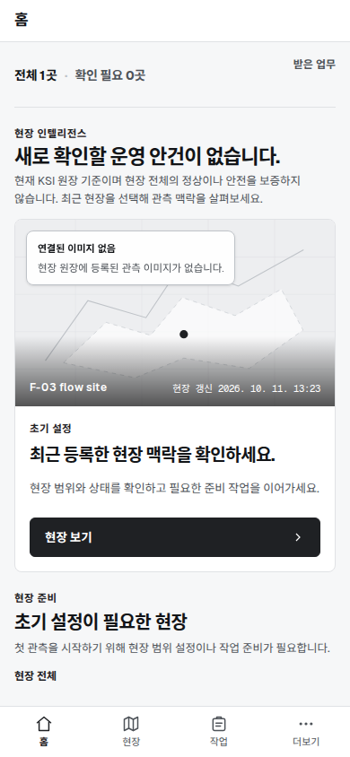 | 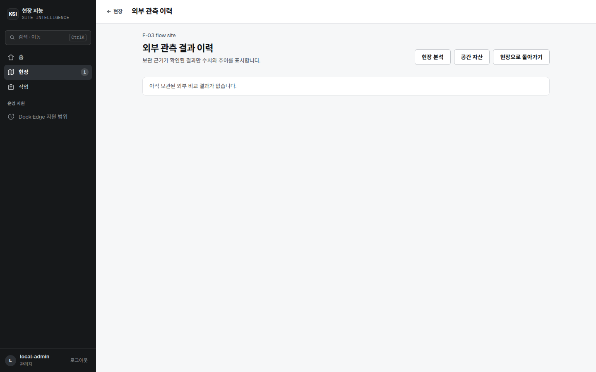 |

## 핵심 기능

| 영역 | 내용 | 소스 |
|---|---|---|
| Operations Console | Home·Sites·현장 5탭(개요·관측·자산·분석·작업), 검토·승인·보고서, 390/768/1024/1440 반응형 | `apps/dashboard/` |
| Site Intelligence Core | Site/WorkArea·외부 WorkOrder·정책·등록·결과·증거·저널의 durable 권위 | `services/core/` |
| Artifact Processing Worker | 외부 산출물 검사·계측, 고정 Analysis, 구역 데이터 준비 — 권위는 Core 소유 | `services/processing-controller/` |
| Bounded MCP 어댑터 | Analysis 6 tools + Spatial Data 6 tools, stdio, 독립 권한·계산·스토리지 없음 | `services/analysis-mcp/`, `services/spatial-data-mcp/` |
| 공용 라이브러리 | domain·contract binding·geo·change/BIM/defect 알고리즘 (import-only) | `packages/` |
| 공간자산 카탈로그 | WorkArea별 자산 revision 조회, 페이지당 50, 유한 조회 예산 초과 시 명시적 503 | `services/core/` + `contracts/` |

상세 책임·실행 경계는 [`REPOSITORY_STRUCTURE.md`](REPOSITORY_STRUCTURE.md)를 따릅니다.

## 동작 흐름

### 분석 경로 (주간 토공 예시)

```text
1. 현장·WorkArea 선택
2. 두 시점 관측 선택 (t0 → t1, 다음 주 t1 → t2 재사용)
3. Core가 호환성·권한·정책 확인 후 실행 기록
4. 고정 프로파일로 변화·높이·상대물량 계산
5. 출처·좌표·변환·유효/제외영역과 함께 결과·근거 조회
6. 사람 검토 → 다음 관측·작업 연결
```

### 데이터 경로 (외부 활용 예시)

```text
1. Site/WorkArea/Epoch/submission revision으로 자료 탐색
2. 용도별 사용 가능 여부 확인 (등록≠검증≠정량사용)
3. DSM·정사영상 구역 데이터 준비 (범위·CRS·수직기준·단위·NoData·계보 포함)
4. 외부 산업 소프트웨어·고객 코드·선택 MCP에서 활용
```

### 외부 재구성 입력 경계

```text
M4D 촬영 → 고객 통제 현장 PC 재구성 → 파생 산출물·근거 KSI 등록/검사 → 분석·검토
```

원본 사진은 고객 장비에 남고, KSI에는 필요한 파생 산출물과 provenance/품질 근거만 등록됩니다.

## 시스템 구성

```text
고객 재구성 산출물 → Core: 자산·시점·구역·버전·권한·용도별 적합성
                      ├─ 데이터 준비 워커 → 구역 데이터·공간 메타데이터·가공 계보
                      └─ 분석 워커 → 고정 계산·결과·근거
                              Core 공통 API
                      ├─ 외부 산업 소프트웨어 / 고객 코드
                      ├─ MCP → 선택한 외부 에이전트
                      └─ Console: 등록·상태·보완·근거·접근 관리
```

- Core 조립: `assemble_platform_app` / `build_platform_production_app`
- 워커 7종 스크립트 + Spatial/Analysis 소비자
- 취득·비행·Edge 실행은 현행 플랫폼 책임 밖 — 관련 출처는 `archive/acquisition-2026/`에 역사적 증거로 보존
- DJI Flight Controller가 저수준 비행 안전(안정화·회피·RTH)을 계속 소유, Core·LLM은 비행 좌표/명령을 만들지 않음

전체 구성 한 장 개요는 [`docs/architecture/00_SYSTEM_OVERVIEW.md`](docs/architecture/00_SYSTEM_OVERVIEW.md).

## 기술 스택

| 층 | 스택 |
|---|---|
| Console | Next.js 16, React 19, TypeScript 5, Tailwind v4, Leaflet·GeoTIFF·proj4, next-auth (OIDC), Vitest·Playwright·axe-core |
| Core | Python 3.12, FastAPI, Pydantic 계약, append-only 저널, S3 호환 증거 스토리지 |
| 공간·분석 | rasterio/GDAL·pyproj(CRS·수직기준), 고정 외부 프로파일 `external-geotiff-profile.v1`, checkpoint 봉인 CSV 직접 대조 |
| MCP·소비자 | stdio 6+6 고정 도구, HTTP 소비 코드, 예시 workflow |
| 배포·운영 | Docker Compose (Core·MinIO·Dashboard·Caddy), systemd, versioned resource policy + OCI digest pin |

## 검증 현황

> 로컬 소프트웨어 검증 근거이며 현장·고객 수용을 대체하지 않습니다. (2026-10-13 기준)

| 게이트 | 결과 |
|---|---|
| Contract 전체 | 5484 passed · 25 skipped · 0 failed |
| Core 타입 | broad mypy 760 files Success |
| 아카이브 경계 | strict archive exit 0 (251/251) |
| Dashboard 단위 | vitest 788 · tsc/eslint 0 |
| Console 검토 지속성 | 201 → 새로고침 → Core 재기동 유지 (증거 `apps/dashboard/f04-review-evidence/`) |
| Site bootstrap | 서버 발급 ID·멱등 binding·same-Site scope (증거 `apps/dashboard/f01-bootstrap-evidence/`) |

열린 항목(정직 표기): 실자료 A–E provisioning, 샌드박스 VM parser 실체인, 2-cycle 완주,
production/TLS·고객·EXT-VAL 수용, GitHub Actions 결제 차단. 상세는
[통합 감사](docs/audit/PHYSICAL_SITE_REBASELINE_INTEGRATED_VERIFICATION.md)와
[정본 원장](docs/superpowers/plans/2026-10-07-agent-first-platform-rebaseline.md).

## 5분 만에 로컬 실행

```bash
# 1. Console + Core + Local Identity (loopback)
cd apps/dashboard
npm run dev
# 표시된 MagicDNS URL로 접속 (tailnet 전용)

# Tailscale 없이 localhost로만 볼 때
npm run dev:local
```

```bash
# 2. 품질 게이트 (변경 전 제출 기준)
npm test && npm run lint && npx tsc --noEmit && npm run build
npm run test:e2e   # 390/768/1024/1440 + OIDC + 접근성
```

```bash
# 3. Core 계약 테스트 (발췌)
uv run pytest tests/contract -q
```

상세 운영·배포 경계는 [`deploy/README.md`](deploy/README.md), [`docs/ops/DEPLOYMENT.md`](docs/ops/DEPLOYMENT.md).

## 프로젝트 구조

| 경로 | 책임 |
|---|---|
| `apps/dashboard/` | KSI Operations Console |
| `services/core/` | Site/WorkArea·외부 WorkOrder·정책·결과·증거·저널 |
| `services/processing-controller/` | 검사·계측 워커 (Core가 권위 판정) |
| `services/analysis-mcp/`, `services/spatial-data-mcp/` | bounded stdio 어댑터 |
| `packages/` | domain·geo·change/BIM/defect import-only 라이브러리 |
| `contracts/`, `tests/contract/`, `tests/replay/` | 스키마·적합성·재현 검증 |
| `archive/acquisition-2026/` | 역사적 취득 출처 (런타임·빌드 입력 아님) |
| `docs/` | 제품 정본·ADR·수용·감사·운영 |

## 문서 안내

1. [`docs/00_READ_FIRST.md`](docs/00_READ_FIRST.md) — active hierarchy
2. [`docs/product/PRODUCT_CONSTITUTION.md`](docs/product/PRODUCT_CONSTITUTION.md) — 제품 정체성·경계
3. [`docs/product/FINAL_DECISION_LEDGER_v1.0.md`](docs/product/FINAL_DECISION_LEDGER_v1.0.md) — durable 결정
4. [`docs/product/MASTER_PRD_v3.0.md`](docs/product/MASTER_PRD_v3.0.md) — 요구사항 본문
5. [`contracts/`](contracts/) — wire·스키마 정본
6. [`docs/architecture/00_SYSTEM_OVERVIEW.md`](docs/architecture/00_SYSTEM_OVERVIEW.md) — 전체 구성 한 장
7. [`docs/DOCUMENT_STATUS.md`](docs/DOCUMENT_STATUS.md) — 현행 vs 역사 구분

아키텍처 결정: [ADR-036 고객 재구성](docs/architecture/ADR-KSI-036-customer-reconstruction-and-result-ingress.md) ·
[ADR-037 API-first](docs/architecture/ADR-KSI-037-api-first-earthwork-evidence-and-integration.md) ·
[ADR-038 플랫폼](docs/architecture/ADR-KSI-038-spatial-data-and-analysis-platform.md) ·
[ADR-039 취득 분리](docs/architecture/ADR-KSI-039-physical-site-intelligence-and-acquisition-separation.md)

## 책임 경계

- KSI는 자체 사진측량 엔진·고객 production 재구성 서비스를 운영하지 않습니다.
- DJI Terra·RTK FIX 언급은 초기 현장 검증·재구성 **입력 참조 흐름**이며 라이선스·내보내기 호환·자동연동·정확도·현장 수용의 주장이 아닙니다.
- 기하 변화·증감·순물량·설계 차이는 승인·진척·정산·품질·측량·현장 수용의 증거가 아닙니다. 계약 정산·측량급 결과는 별도 수용 근거 없이는 제품 주장이 아닙니다.
- Point cloud·Mesh·외부 분석 레이어·추가 클라이언트는 후속 계약·수용 대상입니다.

## 문의

- **주식회사 케이에스아이 (KSI Corporation)**
- 대표번호: **043-288-4860**
- 도입 상담: 현장 규모·관측 주기·활용 시스템(MCP/API/Console)·데이터 제공 범위를 알려주시면 적합 범위와 다음 단계(데모·합성 검증·실자료 파일럿)를 안내합니다.
- 저장소: `ksi-site-intelligence-platform` — 이슈·PR 환영 (비밀·원본 매체·개인키는 올리지 마세요)
